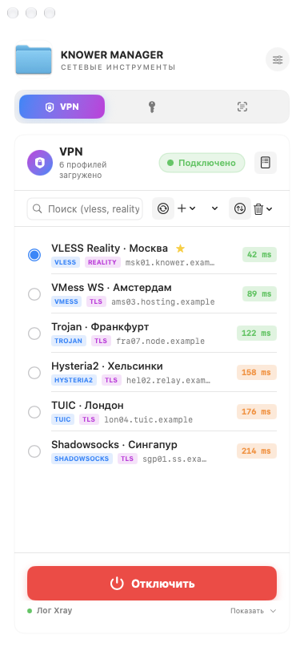
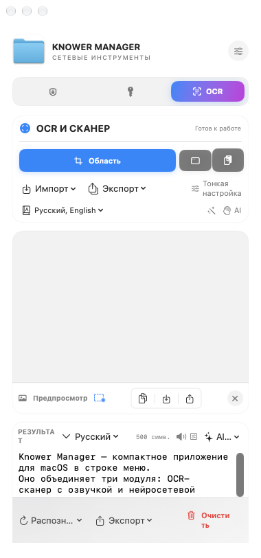
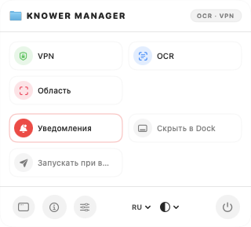

# Knower Manager

**Русский** · [English](README.en.md)

[](https://github.com/KnowerLife/KnowerManager/actions/workflows/build.yml)
[](LICENSE)
[](#требования)

**Knower Manager** — компактное приложение для macOS в строке меню, объединяющее два инструмента в одном окне шириной 380 pt:

- 🖥 **OCR-сканер** — распознавание текста локально через **Apple Vision**, с озвучкой и нейросетевой обработкой;
- 🔒 **VPN-клиент** — подключение через **Xray**: VLESS, VMess, Trojan, Shadowsocks, Hysteria2, TUIC и другие протоколы.

Быстрый доступ ко всему — из строки меню: вкладки, захват области экрана, переключатели, язык и тема. История изменений — в [CHANGELOG.md](CHANGELOG.md).

---

## Скриншоты

<p align="center">
  
  
</p>
<p align="center">
  
</p>

*Слева направо: VPN (Xray), OCR-сканер и меню в строке меню. Скриншоты сделаны на macOS 27.*

---

## Содержание

- [Возможности](#возможности)
  - [OCR и сканер](#ocr-и-сканер)
  - [VPN (Xray)](#vpn-xray)
  - [Приложение и интерфейс](#приложение-и-интерфейс)
- [Требования](#требования)
- [Сборка](#сборка)
- [Крупные бинарные ресурсы (Git LFS)](#крупные-бинарные-ресурсы-git-lfs)
- [Структура проекта](#структура-проекта)
- [Локализация и темы](#локализация-и-темы)
- [Конфиденциальность](#конфиденциальность)
- [Лицензия](#лицензия)
- [Отказ от ответственности](#отказ-от-ответственности)

---

## Возможности

### OCR и сканер

Распознавание текста на базе **Apple Vision**, полностью локально на устройстве.

- **Захват:** область экрана, весь экран, буфер обмена.
- **Импорт:** файлы изображений, PDF, сканирование с подключённого сканера (ImageCaptureCore).
- **Многостраничный режим** с историей страниц и перераспознаванием отдельной страницы.
- **Языки:** 24 языка распознавания — RU, EN, DE, FR, ES, IT, PT, UK, PL, TR, NL, SV, DA, NO, FI, CS, ZH‑Hans, ZH‑Hant, JA, KO, AR, HE, TH, VI. Автоопределение языка.
- **Тонкая настройка:** точный / быстрый уровень распознавания, языковая коррекция, пользовательские слова, минимальная высота текста, ориентация изображения, показ рамок текста, определение штрих‑кодов.
- **Предобработка изображения:** ч/б, контраст, яркость, резкость, инверсия, бинаризация с порогом, апскейл.
- **Экспорт:** TXT, Markdown, JSON, PDF с текстовым слоем. Опция «брать текст из PDF» (использовать встроенный слой без распознавания).
- **Озвучка (TTS):** выбор **языка озвучки** (независимо от языка текста) и голоса, скорость воспроизведения; пауза / продолжить / стоп; язык берётся из текста или задаётся вручную.
- **Язык текста и распознавания у результата:** бейдж языка открывает меню (задать язык текста вручную или вернуть автоопределение — это влияет и на озвучку); «Распознать заново» перераспознаёт страницу сразу в выбранном языке.
- **AI‑обработка текста:** Переписать, Улучшить, Сократить, Перевести, Исправить орфографию, Расширить, Официальный / Неофициальный стиль, Перевод на русский.
  Провайдеры: **DeepSeek**, **OpenAI**, **Anthropic**, локальный **Ollama**. Отображение баланса DeepSeek.

### VPN (Xray)

Клиент на базе **Xray-core** с собственным генератором конфигураций.

- **Протоколы:** VLESS (Reality, Vision, gRPC, WS, HTTPUpgrade, SplitHTTP, H2, KCP, QUIC), VMess, Trojan, Shadowsocks (SIP002 и legacy), Hysteria2, TUIC, SOCKS5, HTTP(S).
- **Импорт:** ссылка из буфера обмена, файл, URL, **QR‑код** из изображения (Vision). Экспорт профиля в QR‑код.
- **Подписки:** добавление по URL, автообновление (проверка каждые 5 минут), трафик и срок действия (`subscription-userinfo`), произвольный User-Agent, стабильные ID профилей при обновлении.
- **Проверка соединений:** TCP‑пинг, сортировка по пингу, «глубокое» сканирование (параллельные воркеры, запуск Xray на отдельном порту и проверка связности через curl).
- **Реальный тест через прокси:** задержка (HEAD 204 через SOCKS) и скорость загрузки (8 МБ, speed.cloudflare.com).
- **Живой лог Xray:** захват stdout/stderr в кольцевой буфер, сворачиваемая панель.
- **Правила маршрутизации** в стиле Xray: домены, IP, порты, протоколы (http/tls/quic/bittorrent), действие (прокси / напрямую / блок), сеть (tcp/udp/tcp+udp). Добавление, редактирование, копирование, сортировка; правила без условий пропускаются при генерации.
- **Управление профилями:** поиск, фильтр по источнику (все / ручные / конкретная подписка), мультивыбор, ручное добавление и редактирование.

### Приложение и интерфейс

- **Иконка в строке меню (трей)** с popover: быстрое открытие вкладок (VPN / OCR), захват области экрана, переключатели «уведомления», «скрыть иконку в Dock», «запуск при входе», выбор языка и темы, окно «О программе», выход.
- **Две вкладки:** VPN (Xray) и OCR — в окне шириной 380 pt с высотой, адаптирующейся под содержимое.
- **Темы:** системная / светлая / тёмная.
- **Языки интерфейса:** русский и английский.
- «Забыть сохранённый пароль администратора» в настройках.

---

## Требования

- **macOS 13.5** (Ventura) или новее.
- **Xcode 16** или новее (проект `KnowerManager.xcodeproj`, схема `KnowerManager`).

---

## Сборка

Крупные ресурсы проекта хранятся в **Git LFS**, поэтому сначала установите LFS:

```bash
brew install git-lfs
git lfs install
```

Затем:

```bash
git clone git@github.com:KnowerLife/KnowerManager.git
cd KnowerManager
xcodebuild -project KnowerManager.xcodeproj -scheme KnowerManager -configuration Debug build
```

Если репозиторий уже склонирован без LFS — подтяните ресурсы:

```bash
git lfs pull
```

Либо откройте `KnowerManager.xcodeproj` в Xcode и запустите схему **KnowerManager**.

Готовый `.app` появится в `DerivedData` (или в `Products` при сборке из Xcode).

---

## Версионирование

Версия (`MARKETING_VERSION`) и билд (`CURRENT_PROJECT_VERSION`) задаются в
`KnowerManager.xcodeproj/project.pbxproj` и автоматически попадают в `Info.plist`
(файл генерируется самой сборкой: `GENERATE_INFOPLIST_FILE = YES`).

На **каждое обновление поднимаются оба значения**: билд всегда `+1`, версия —
`+1` в последней цифре (patch). Например: `3.0 (31) → 3.0.1 (32)`.

Это делается скриптом (он же синхронизирует заголовок `CHANGELOG.md`):

```bash
scripts/bump_version.sh             # build +1, patch +1   (по умолчанию)
scripts/bump_version.sh --minor     # build +1, минор +1    (3.0.1 → 3.1)
scripts/bump_version.sh --major     # build +1, мажор +1    (3.1 → 4.0)
scripts/bump_version.sh --build-only
scripts/bump_version.sh --set 3.2.1 # явная версия + build +1
```

Чтобы не забывать, после клонирования установите git-хук — он поднимает версию
и билд автоматически перед каждым коммитом:

```bash
scripts/install_hooks.sh
```

Пропустить бамп для отдельного коммита: `git commit --no-verify` либо
`SKIP_VERSION_BUMP=1 git commit ...`.

---

## Релизы

Релиз публикуется workflow `.github/workflows/release.yml` двумя способами:

1. **Вручную** — GitHub → **Actions** → **Release** → *Run workflow* → выбрать, на
   сколько поднять версию (`patch` / `minor` / `major` / `none`). Workflow сам:
   поднимет версию и билд, закоммитит, поставит тег `vX.Y.Z`, прогонит тесты,
   соберёт `KnowerManager.app`, упакует в zip и создаст GitHub Release.
2. **Тегом** — `git tag v3.0.2 && git push origin v3.0.2`. Версия берётся из тега,
   bump не выполняется; workflow собирает и публикует Release для этого тега.

Проверка обновлений в приложении («Настройки → Проверить обновления») читает
список релизов через GitHub API и сравнивает тег (`vX.Y.Z`) с
`CFBundleShortVersionString`. Чтобы обновление «увиделось», нужен **релиз с тегом
новее установленной версии**.

> Сборка в CI — **без подписи** (`CODE_SIGNING_ALLOWED=NO`). При первом запуске
> скачанного `.app` macOS может показать предупреждение Gatekeeper. Снять карантин:
> `xattr -dr com.apple.quarantine /путь/KnowerManager.app`.

---

## Крупные бинарные ресурсы (Git LFS)

Три файла хранятся в репозитории через **Git LFS** (см. `.gitattributes`):

| Файл | Назначение | Откуда взять |
|------|-----------|--------------|
| `KnowerManager/Resources/Binaries/xray-core` | исполняемый файл Xray (universal: arm64 + x86_64) | [XTLS/Xray-core releases](https://github.com/XTLS/Xray-core/releases) |
| `KnowerManager/Resources/Data/geoip.dat` | база GeoIP для правил маршрутизации | [Loyalsoldier/v2ray-rules-dat releases](https://github.com/Loyalsoldier/v2ray-rules-dat/releases) |
| `KnowerManager/Resources/Data/geosite.dat` | база доменов для правил маршрутизации | [Loyalsoldier/v2ray-rules-dat releases](https://github.com/Loyalsoldier/v2ray-rules-dat/releases) |

Склонируйте с установленным Git LFS — файлы подтянутся автоматически. Если LFS недоступен, скачайте файлы вручную по путям из таблицы и выдайте права на выполнение бинарнику:

```bash
chmod +x KnowerManager/Resources/Binaries/xray-core
```

---

## Структура проекта

```
KnowerManager/
├── App/            # Точка входа и главные View (KnowerApp, ContentView, MiniMenu, AboutView)
├── Core/           # Ядро: SettingsManager, MenuBarManager, PrivilegedRunner, GeneralSettingsSheet
├── Design/         # Дизайн-система и токены (DesignTokens, Components, UXUIKit, NeonTheme…)
├── Language/       # Локализация: StringKey + LocalizationRU/LocalizationEN
├── VPN/            # Xray-клиент
│   ├── Models/      # Профили, подписки, Shadowsocks-модели
│   ├── Parsers/     # SS, VMess, VLESS, Hysteria2, TUIC, SOCKS/HTTP + LinkParser
│   ├── Routing/     # Правила маршрутизации (RoutingManager, RoutingView, RoutingRuleEditor)
│   ├── Services/    # XrayService, XrayConfigGenerator, SubscriptionManager, ProfileProxyTester
│   ├── Utils/       # LinkParser, LinkExporter, QRCodeService, TCPPing
│   └── Views/       # SSConnectionView, SubscriptionsView, ProfileEditView, QRExport, SpeedTest
├── OCR/            # Захват экрана, распознавание, озвучка, экспорт
│   ├── Models/      # OCR-модели и опции (языки, предобработка, TTS, форматы экспорта)
│   ├── Services/    # OCRManager, OCRService, SpeechService, DocumentImportService…
│   ├── Utils/       # ScreenCaptureService, ScannerDeviceView
│   └── Views/       # ScannerView, OCRSheets
├── Services/       # AI (AIService), Keychain (KeychainHelper)
└── Resources/      # Assets.xcassets, Binaries и Data (в Git LFS)
```

---

## Локализация и темы

- Все пользовательские строки вынесены в папку `KnowerManager/Language/`:
  `StringKey` (ключи) + `LocalizationRU` / `LocalizationEN` (переводы).
  Чтобы добавить строку — заведите кейс в `StringKey` и перевод в обоих файлах.
- Поддерживаются русский и английский языки интерфейса, а также системная / светлая / тёмная темы.

---

## Конфиденциальность

- API‑ключи AI‑провайдеров и пароль администратора (`sudo`) хранятся в **Keychain**, а не в `UserDefaults`.
- Профили VPN, правила маршрутизации и подписки хранятся локально (в `UserDefaults` / `Application Support`).
- Приложение **не отправляет** ваши данные третьим лицам, кроме прямых запросов к выбранным вами сервисам (AI‑провайдер, серверы подписок и проверок соединений).

---

## Лицензия

Проект распространяется под лицензией **MIT** — см. файл [LICENSE](LICENSE).

---

## Отказ от ответственности

Приложение предоставляется «как есть», без гарантий. Пользователь самостоятельно несёт ответственность за соблюдение местного законодательства и правил использования сетей и сервисов.